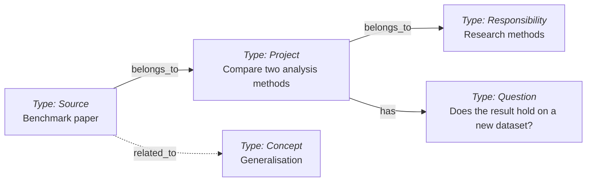

# Second Brain template

A knowledge base made of **Markdown notes, YAML frontmatter and links**, independent of any AI provider: a folder of readable files you can copy, back up or move between tools, whose linked notes keep context, sources and decisions between conversations. You can use it by hand in any Markdown editor; a coding agent with filesystem access makes capture, retrieval and maintenance much easier. It builds on [Portent](https://github.com/refactoringhq/portent), an open specification for portable knowledge bases.

Two viewers are optional: [Tolaria](https://tolaria.md/), a desktop app for browsing and editing this kind of vault, and [Brain Graph](https://github.com/mfoll/brain-graph), a companion repository that draws the whole vault as an interactive map. The repository installs no applications, enables no scheduled jobs and needs no search index.


*[Brain Graph](https://github.com/mfoll/brain-graph) drawing one of the [example vaults](#example-vaults) while two agents work in it: the notes they read glow blue, a dot runs along each link they follow, and the notes they write glow red. **[Explore the nine example vaults in the live demo](https://mfoll.github.io/brain-graph-demo/)**, nothing to install.*

[How it works](#how-it-works) · [Start here](#start-here) · [Start your first focus](#start-your-first-focus) · [A worked session](#a-worked-session) · [Example vaults](#example-vaults) · [What it adds to Portent](#what-it-adds-to-portent) · [Design decisions](#design-decisions) · [Responsible use](#responsible-use) · [Everyday use](#everyday-use) · [Other tools](#relationship-to-other-tools) · [Repository map](#repository-map) · [Licence](#licence)

Reference material lives in two Guides: the [Model Reference](model-reference.md) (types, file format, relationships, lifecycle, views, extending the model, interoperability) and [Agent Setup](agent-setup.md) (instruction layers, Skills, audits, external files, automation, checkpointing).

## How it works

- **Notes are files.** Each `.md` file has readable text and a YAML header, called frontmatter, for structured properties.
- **Types say what a note is.** `type: Project` describes current work; `Source`, `Concept` and `Question` distinguish source material, reusable ideas and unresolved issues. The 17 [Type definitions](model-reference.md#note-types) explain their conventions and can be extended.
- **Relationships say how notes connect.** `belongs_to` names the parent, `has` selects useful entry points, and `related_to` links relevant notes. Body links add context.
- **Agents can read and write the graph.** With filesystem access, a coding agent follows the instructions, Type definitions and Procedures to find, structure, link and update notes. No graph database or separate retrieval index is required.

A study comparing two analysis methods can link a benchmark paper, an open validation question and the concept of generalisation:



Each box is one note; arrow labels name fields stored in the note they leave. These fictional notes illustrate the model; the [Model Reference](model-reference.md#files-and-relationships) shows the YAML behind them.

## Start here

To see what a vault looks like after two years of use before building your own, clone one of the [example vaults](#example-vaults) and open it in any Markdown editor, [Tolaria](https://tolaria.md/) or [Brain Graph](https://github.com/mfoll/brain-graph).

1. Create your own private copy in a new folder: click **Use this template** on GitHub, or clone or download the repository. Copy the hidden `.agents/` folder and `.gitignore` too, which some copy tools skip, but not a clone's `.git` folder, which would still point at this template. If you already have a vault, use [Upgrade an Existing Vault](upgrade-existing-vault-from-template.md) instead to bring selected changes into it.
2. Open the folder in your usual Markdown editor. A vault is simply this folder of notes and their operating rules.
3. Give [vault.md](vault.md) a name and purpose, then replace this README with the short vault README from the [deployment guide](deploy-vault-from-template.md), which records the copy's scope and privacy boundary once. If you use an agent, customize [AGENTS.md](AGENTS.md) for that same scope and remove its template-only section.
4. Pick one real thing you are working on and one non-sensitive piece of material that would help with it. Follow [Start your first focus](#start-your-first-focus) below; you do not need to plan the whole structure first.
5. Use the notes as they are. Add [agent routing](agent-setup.md), Skills, external-file helpers, views or automation only when useful. Keep existing project documentation in its canonical location and link to it.

Each [release](https://github.com/mfoll/second-brain-template/releases) marks a reviewed version of the template; note the one you copied, so that a later [upgrade](upgrade-existing-vault-from-template.md) can list what changed since.

Basic note use needs a text editor. Git adds history and rollback; the optional [GitHub deployment walkthrough](deploy-vault-from-template.md) uses Git and the GitHub CLI. Python 3.9 or later is needed only for the bundled audit helpers, which work in a plain folder as well as in a Git repository; the Python that ships with macOS is enough.

### Or let an agent set it up

Paste this into Claude Code, Codex, Gemini CLI or another agent that can work with files, replacing the folder:

```text
Set up a Second Brain for me from https://github.com/mfoll/second-brain-template
in <FOLDER>. Follow its deployment guide's agent-led setup.
Interview me before writing anything.
```

The agent copies the template, then asks a few questions one at a time: what the vault is for, what stays out of it, where your material lives, which AI tools may process it, how it is backed up, and what it may save without asking. It writes the agreed setup, starts your first focus with you and checks that you can find what was saved. Skills, Git history, connections and automation stay off unless you choose them.

One question deserves a moment: **should your agents use the Brain when you work in other folders?** If you say yes, the agent adds a short marked block to the user-level instruction file of the agents you choose, so that any session, in any project, knows where your notes are and can read or update them when that helps. The trade-off is that agents working on unrelated tasks may then read relevant notes and send them to their model provider. The agent shows you the exact change first and keeps a recovery copy; deleting the block undoes it. If unsure, say no: the Brain still works whenever the agent is opened in the vault folder, and you can add this later. The [deployment guide](deploy-vault-from-template.md#explain-the-choice-to-use-the-brain-from-other-folders) has the details.

## Start your first focus

A focus is anything you want the brain to help with: an ongoing area such as teaching, a finite outcome such as preparing a workshop, or a subject you are exploring. Start with something you already need to do and one useful document, public link or idea. You can add more later; there is no need to import your entire archive or design every category at the start.

With a filesystem agent, open your copied vault as its working folder and ask:

```text
Use the start-a-focus skill: I want to prepare a workshop.
```

Without the Skill installed, ask the agent to follow [Start a Focus](procedures/start-a-focus.md). It interviews you briefly (what you want to achieve, whether it ends, what it belongs to, what material exists), searches existing notes, then proposes the smallest structure in plain language and waits for your agreement before writing. The same workflow starts every later focus.

For example, the result could be:

| What you need to remember | Note | Why it exists |
| --- | --- | --- |
| An ongoing area of work | Responsibility: Teaching | Gives related projects a stable home. |
| A finite outcome | Project: Prepare workshop | Keeps the outcome, current state, open questions and next actions together. |
| Material you will use | Source: Workshop reference | Keeps provenance and useful findings linked to the Project. |

If the first item is your own idea, the agent can update the Project or choose another existing Type; it should not label your idea an external Source. If you work by hand, use the [Responsibility](responsibility.md), [Project](project.md) and relevant knowledge Type templates to make the same small structure.

Give the agent the actual link, file or text and say why you want to keep it:

```text
Save this reference under the workshop project: <LINK OR FILE>.
It may help explain <TOPIC>. Read the material, preserve its provenance,
and capture what is useful for this workshop, including limits or caveats.
Tell me what you saved, where it belongs and anything you could not access.
```

Review the resulting notes. Can you open the Project and find the reference? In a fresh conversation with the agent working in the vault, ask: “What reference did we save for the workshop, why is it useful, and what remains to do?” A useful answer from the files is the first success criterion. If it cannot find the material, improve the entry note and links before adding more content or tooling.

Keep existing documents in their original locations and link to them. Save the knowledge needed for future use in the vault; copying every file is not required. The [deployment guide](deploy-vault-from-template.md) covers the technical setup and checks.

## A worked session

What the operating rules look like in use, on the fictional study above:

```text
You:   Note this in my brain: the benchmark paper shows Method B generalises
       worse than A on small datasets. We still need to test on a new dataset
       before the study concludes.

Agent: Created Source benchmark-paper under Project compare-analysis-methods,
       with the URL as provenance and a lateral link to Concept generalisation.
       Opened Question does-the-result-hold-on-a-new-dataset (status: Open) and
       listed it under the Project's Open Questions. Replaced the Project's
       Current State bullet on the comparison and added one Next Action.
       Lint: no new findings.
```

Behind that reply: [Ingest Source](procedures/ingest-source.md) chose the Source type and the parent, the hierarchy rule placed the note under the Project that answers for it, the [Project contract](project.md) made the agent reconcile Current State instead of appending a dated line, and [Lint Vault](procedures/lint-vault.md) confirmed the graph still resolves. Nothing was published or sent to anyone; the agent's model provider did receive the text it read, which is why the responsible-use boundaries below are agreed once before the first session. The note stays a file you can edit.

## Example vaults

Nine demo vaults show the template after about two years of fictional daily use, each with 500 to 800 linked notes, a lived-in Git history and a guided tour with questions that have known answers. Everything about the people and organisations is invented; the literature they cite is real. Clone one and open the folder, or [explore all nine in the live Brain Graph demo](https://mfoll.github.io/brain-graph-demo/) without installing anything.

| Vault | Whose memory |
| --- | --- |
| [Varga Lab Brain](https://github.com/mfoll/second-brain-demo-cancer-lab/blob/main/README.md) | A group leader running a cancer genomics and molecular epidemiology lab |
| [Hollowgate Bakehouse Brain](https://github.com/mfoll/second-brain-demo-cafe/blob/main/README.md) | The owner of an independent café and bakery |
| [Marchbank Teaching Brain](https://github.com/mfoll/second-brain-demo-teacher/blob/main/README.md) | A secondary-school history teacher and head of year |
| [Brennick Design Brain](https://github.com/mfoll/second-brain-demo-freelancer/blob/main/README.md) | A freelance product designer |
| [Brierly Household Brain](https://github.com/mfoll/second-brain-demo-household/blob/main/README.md) | A parent keeping a family's home, care, school and money records |
| [Fernhollow Club Brain](https://github.com/mfoll/second-brain-demo-community-club/blob/main/README.md) | The volunteer chair of a neighbourhood sports and youth club |
| [Quayle Writing Brain](https://github.com/mfoll/second-brain-demo-novelist/blob/main/README.md) | A novelist writing her second book |
| [Arneberg Engineering Brain](https://github.com/mfoll/second-brain-demo-startup/blob/main/README.md) | The engineering lead of a small software start-up |
| [Castellane HR Brain](https://github.com/mfoll/second-brain-demo-hr-assistant/blob/main/README.md) | An HR assistant in a large company |

## What it adds to Portent

This template adapts the [Portent Vault Template](https://github.com/refactoringhq/portent-vault-template) and builds on [Portent](https://github.com/refactoringhq/portent), Refactoring’s open specification for portable knowledge bases. Portent supplies the vocabulary: the core types, relationships and lifecycle. This repository adds what an agent needs to keep a vault in shape over months of use:

- **Operating rules.** [AGENTS.md](AGENTS.md) holds the vault's operating rules for agents, with three instruction layers (global, vault, project pointer) and explicit write, provenance and external-file boundaries.
- **Workflows and packages.** Seventeen [Procedures](procedures/) for ingestion, inbox processing, project upkeep, validation and checkpointing. Eight selected workflows are also exposed as optional thin [Skill packages](.agents/skills/) that point an agent to the Procedure rather than repeat it; [Agent Setup](agent-setup.md#why-skills-are-thin) explains why.
- **A decision record.** Eleven [ADRs](adr/) explain why the structure is the way it is, with the alternatives rejected and the signal that would reopen each decision, so that an agent does not relax a rule in the first ambiguous case. They are listed [below](#design-decisions).
- **Enforcement.** Lint scripts check required note metadata, Skill pairs, links, compactness, icon names and the `belongs_to` hierarchy, and the health review turns their findings into promotion proposals. The hierarchy contract fills the one gap Portent leaves open: every durable note rolls up to a Responsibility, Topics stay lateral, and a note has a named home before it has a project.

These additions were worked out on a real professional vault, in daily use with agents since April 2026, and ported back once they proved generic. Conventions still change; each change lands as an ADR.

## Design decisions

The eleven ADRs, one line each. Each records its context, the options rejected and the signal that would reopen it.

1. [Treat the Markdown graph as the portable brain](adr/0001-treat-markdown-graph-as-portable-brain.md): notes, frontmatter, links and Git are the system; viewers and agents are replaceable.
2. [Project-scoped memory](adr/0002-use-project-scoped-memory-for-agent-workspaces.md): a workspace points to one Project note through a compact memory section, and agents start there.
3. [Record vault decisions as ADRs](adr/0003-use-adrs-for-vault-design-decisions.md), superseding rather than rewriting.
4. [Hybrid layout](adr/0004-use-hybrid-layout-with-frontmatter-as-semantic-source.md): core notes and Types at the root, ADRs, Procedures and views in folders; frontmatter is the semantic source.
5. [One Source type](adr/0005-use-source-as-single-external-ingestion-type.md) for all external material, with provenance fields.
6. [Active subprojects get their own Project note](adr/0006-use-project-notes-for-active-subprojects.md) under an umbrella.
7. [Compact front page](adr/0007-keep-hot-path-memory-compact-and-single-sourced.md): established Projects target 600–1,200 words with linked detail; small starters can be shorter.
8. [Semantic reachability and reversible compaction](adr/0008-require-semantic-reachability-and-reversible-compaction.md): nothing is trimmed until its payload has a verified home.
9. [Skill packages](adr/0009-support-procedure-backed-and-specialized-skill-packages.md) are vault-owned and catalogued, either Procedure-backed or explicitly standalone.
10. [A Project note implies no folder](adr/0010-decouple-brain-projects-from-local-workspaces.md): promote to a workspace only past a stated threshold.
11. [`belongs_to` roots at Responsibilities](adr/0011-root-belongs-to-at-responsibilities-and-home-exploration-clusters-in-topics.md): Topics stay lateral, and exploration clusters have a home before a project.

## Responsible use

Set the boundaries once when configuring a vault: which sources it may use, which AI tools and accounts may process them, who may read the notes, where backups live, and how long material should be retained. Keep professional and private content in their appropriate vaults. These choices should reflect your organization's policies and any obligations attached to the source material.

**AI processing.** An agent may send the contents of files it reads to its model provider, even during a read-only task. Choose tools and account settings appropriate for your data, including provider retention and training terms. Use services approved for the material you work with, and keep personal, confidential or otherwise restricted information out of unsuitable tools and storage. Keep credentials out of model prompts and share only the context needed for the task.

**Meetings and other people.** If you use meeting recordings or transcripts, inform participants and obtain their agreement before recording and for the intended transcription, AI processing, retention and sharing. Respect refusals and off-record discussions. Keep notes about people relevant and proportionate, and exclude incidental or overheard conversations. A summary can still contain personal or confidential information.

**Storage and retention.** A private Git repository can still be copied, cloned and shared with collaborators. Keep raw audio, transcript exports, secrets and sensitive source documents outside Git in suitable storage. `.local/` is ignored for machine-local configuration; the credential-file exclusions in `.gitignore` are an additional safeguard, not a content review. Define retention for both sources and summaries, including correction and deletion handling. Removing a note from the current tree does not erase Git history, backups or provider copies. Preserve original captures through an appropriate backup before clearing them; uploading raw material is never a prerequisite for organizing it.

Agree these boundaries during setup and reuse them for routine work. Seek clarification when a new source, tool, destination or action introduces a material new risk or changes the agreed scope. [AGENTS.md](AGENTS.md) carries this operating rule. Keep this template free of personal or work content, source dumps, credentials, attachments, local roots, caches and generated agent state; put real knowledge in your own deployed copy.

## Everyday use

Use the brain alongside real work. You do not need a separate daily administration session or a particular capture application. When using an agent, work in the vault folder or configure the optional [project routing](agent-setup.md#agent-instructions) so it knows where the notes live. Without an agent, open the Project and make the same updates by hand.

| Moment | What to ask | What should happen |
| --- | --- | --- |
| You find something useful | “Save this reference under my workshop project; keep its caveats.” | Preserve provenance, connect useful knowledge to the Project and update affected synthesis when warranted. |
| You have an idea | “Keep this idea and why we might try it.” | Update an existing note or create a suitable linked note; retain the reasoning. |
| You return to work | “Where did we leave this project, and what remains unresolved?” | Read the saved state, identify open decisions and suggest the next useful step. |
| You finish meaningful work | “Update the project with what we decided and what comes next.” | Reconcile current state and next actions instead of appending another session transcript. |

**Check what was saved.** The agent should explain what it created or updated, where it belongs, how it connects to existing knowledge, and what remains uncertain or inaccessible. Open the notes when the material matters. A good capture preserves useful reasoning and caveats, not just a link or a vague summary. External material goes through [Ingest Source](procedures/ingest-source.md); your own ideas can go directly into the appropriate notes.

### Choose a capture habit

Start with the simplest method you will actually use:

- **Save directly during a conversation.** Ask the agent to save a useful idea, decision or supplied reference while the context is available. No Inbox note is required.
- **Bring selected material yourself.** Supply a link, file or passage when you want it incorporated, with a sentence about why it matters. This does not require connecting the source application.
- **Capture now, organize later.** If immediate organization interrupts you, write unprocessed notes or use the optional [Ready To Ingest](ready-to-ingest.md) scratchpad, then request processing when convenient. Any Markdown editor works; Tolaria is optional.
- **Add an integration only for a recurring need.** Once manual use shows a repeated capture task, choose an appropriate tool and explicitly agree its source scope, privacy boundaries, review step and permitted writes. Email, recordings and other sources depend on separately configured tools; the template provides no automatic connection to them. [Automation](vault-automations.md) is optional too.

Try one method on real work before adding another. Keep what makes useful knowledge easier to save and find; there is no requirement to adopt every capture route or Skill.

### What can you bring into the brain?

Start with items you select and supply yourself. Tell the agent why an item matters and whether you want an answer, a saved note, or proposed updates. “Summarize this” asks for an answer; “Save the useful findings under this project” authorizes a scoped vault update under its rules.

| Material | Simple starting method | What to retain |
| --- | --- | --- |
| Your own idea or a useful conversation | Describe it or supply a passage, then ask to save it | Reasoning, alternatives and caveats in the appropriate existing note. |
| Webpage, paper or reading note | Supply a link, file or excerpt and why it matters | Provenance, useful findings and connections to existing knowledge. |
| Email or message | Supply a selected message, or explicitly select it through an approved connector | The useful decision or context, with attribution and a source pointer; avoid copying an entire mailbox or thread by default. |
| Meeting notes or transcript | Supply the selected material and requested outcome | Confirmed decisions, proposed actions and useful context, keeping attribution and uncertainty visible. Recording and transcription are separate choices. |
| Existing document or project folder | Supply a relevant file or confirmed location | Selected knowledge and a pointer to the original; preserve the existing documents. |

The template includes no email, messaging, recording or transcription connector. An available connector grants no permission to scan an account. If the source cannot be read, the agent should state the gap rather than invent findings. Repeatedly supplying the same source should update its existing note when needed, not create duplicates.

You can also save knowledge without an active project. Give it a home under the relevant ongoing area (Responsibility); create a Project only when there is a finite outcome to pursue. If placement is unclear, preserve the capture and resolve that question rather than forcing a category.

### Keep it useful

When a Project changes, refresh its [summary](procedures/update-project-summary.md) and [next actions](procedures/update-project-next-actions.md). When finding or resuming work becomes difficult, ask for a focused [health review](procedures/review-vault-health.md); use [lint](procedures/lint-vault.md) for structural defects. The audit commands are in [Agent Setup](agent-setup.md#checks-that-keep-the-structure-honest).

A Project note does not need its own folder, repository or agent workspace; [Route Project Work And Artifacts](procedures/route-project-work-and-artifacts.md) explains when one is useful. [Recaps](recap.md), views and scheduled maintenance can be added later if they solve a concrete problem.

### Choosing a skill

The eight Skills are optional shortcuts to the [Procedures](procedures/). The [catalogue](skills/) explains when to choose each one; the executable packages live under [.agents/skills/](.agents/skills/). You can ask for the work in ordinary language or follow a Procedure without installing its Skill.

| What you want to do | Skill | Example request |
| --- | --- | --- |
| Start something new: an area, a project or a subject to explore | [Start a Focus](skills/start-a-focus-skill.md) | “Start a new focus for the workshop I am preparing.” |
| Incorporate external material with provenance and useful synthesis | [Ingest Source](skills/ingest-source-skill.md) | “Add this paper to my brain.” |
| Refresh a Project’s state, scope, blockers and links | [Update Project Summary](skills/update-project-summary-skill.md) | “Bring this Project up to date.” |
| Reconcile completed, changed and new next actions | [Update Project Next Actions](skills/update-project-next-actions-skill.md) | “Update what should happen next.” |
| Check metadata, links, hierarchy and structural contracts | [Lint Vault](skills/lint-vault-skill.md) | “Check for broken links and structural defects.” |
| Judge usefulness, current state and ease of retrieval | [Review Vault Health](skills/review-vault-health-skill.md) | “Review whether this vault still helps me resume work.” |

**Optional: capture now, organize later.** An Inbox is a collection of unprocessed captures, not a required folder or step. You can write separate notes, or use `ready-to-ingest.md` as a reusable scratchpad. These ordinary Markdown files can be edited in any editor; Tolaria provides an optional Inbox interface.

| If you use an intake queue | Skill | Example request |
| --- | --- | --- |
| Organize mixed captures within a requested scope | [Process Inbox](skills/process-inbox-skill.md) | “Organize last week’s captures.” |
| Process only captures marked `ingest_ready: true` | [Process Ready Ingestion Inbox](skills/process-ready-ingestion-inbox-skill.md) | “Process only what I marked ready.” |

These are two selection modes for the same processing, not successive stages. Ready Ingestion selects explicitly queued captures and follows Process Inbox, preserving the reusable intake note and leaving other Inbox material untouched. Process Inbox calls Ingest Source for external material. You can also use Ingest Source directly without either Inbox workflow. Keep the two Inbox Skills only if deferred capture suits your routine; installing them enables no scheduled job.

**The two reviews answer different questions.** Lint checks structural contracts; health review judges whether the knowledge and workflows remain useful. Both default to read-only. Health review uses some of the same audit evidence, but a vault can pass mechanical checks and still have stale summaries or buried decisions.

**The two project updates differ in starting scope.** Summary refresh starts from the Project’s overall state; next-action reconciliation starts from remaining work. Each updates related sections when needed to keep state and actions consistent. Choose the narrower task when only the actions changed.

## Relationship to other tools

These tools and formats address different parts of a knowledge system and can be combined; the [Model Reference](model-reference.md#interoperability) has the detail.

| Approach | What it provides | How this template relates |
| --- | --- | --- |
| [Portent](https://github.com/refactoringhq/portent) and its [vault template](https://github.com/refactoringhq/portent-vault-template) | The core work/knowledge types, relationships and lifecycle, plus starter Markdown Type definitions. | **The foundation of this template.** This repository adapts the starter definitions and adds specialised types, agent operating rules, maintenance workflows, a decision record whose rules are checked by lint, and additive setup guidance. |
| [Obsidian](https://help.obsidian.md/Files+and+folders/How+Obsidian+stores+data) | An application for a local folder of Markdown notes, with properties and internal links. | The files, YAML and wikilinks are familiar. This template adds particular note types, relationship meanings and maintenance workflows; it bundles no Obsidian configuration. |
| Wikis, including [LLM-maintained wikis](https://gist.github.com/karpathy/442a6bf555914893e9891c11519de94f) | Linked pages that accumulate and revise knowledge; an LLM wiki uses an agent to maintain synthesis from sources. | Both use linked, maintained knowledge. This template also defines explicit types, project state and relationships, separates sources from synthesis, and supports human or agent maintenance. |
| Google Cloud's [Open Knowledge Format (OKF)](https://github.com/GoogleCloudPlatform/knowledge-catalog/blob/main/okf/SPEC.md) | A format for exchanging knowledge as Markdown files with YAML frontmatter, including a required `type` and extensible metadata. | The basic representation is similar. This template adds its own type definitions, typed relations and operating procedures, and makes no OKF conformance claim. |
| [QMD](https://github.com/tobi/qmd) | A local search engine combining keyword search, semantic search and reranking over Markdown files. | Can index the folder as an optional retrieval layer. The notes remain authoritative; the index needs refreshing as files change. |
| Garry Tan's [GBrain](https://github.com/garrytan/gbrain) | A broader agent-memory system with keyword and optional semantic retrieval, graph navigation, synthesis and agent integrations. | Selected retrieval features could complement the notes through a separate integration. It has its own storage and conventions; this template includes no ready-made connector. |

## Repository map

You do not need to read every file before starting or retain every optional feature in a deployed vault.

| Files | Role |
| --- | --- |
| [vault.md](vault.md), [maintain-vault.md](maintain-vault.md), [ready-to-ingest.md](ready-to-ingest.md) | Starter entry Project, maintenance Responsibility and ready-marked intake note. Replace their placeholders in your copy. |
| Root Type definitions | The 17 types, including their templates and conventions. |
| [AGENTS.md](AGENTS.md), [CLAUDE.md](CLAUDE.md), [GEMINI.md](GEMINI.md) | Vault operating rules and small compatibility files that import them for other runtimes. |
| [Model Reference](model-reference.md), [Agent Setup](agent-setup.md) | The two reference Guides behind this README. |
| [Deployment](deploy-vault-from-template.md), [upgrade](upgrade-existing-vault-from-template.md) and [global instruction template](global-agent-instructions-template.md) | Bootstrap and configuration material, to customize or retire after setup. |
| [procedures/](procedures/) | Complete workflows for ingestion, project upkeep, validation, configuration and checkpointing. |
| [skills/](skills/) and [.agents/skills/](.agents/skills/) | Human-readable Skill catalogue and matching executable packages, including the contract, compactness, icon, hierarchy and link audits. The eight packages are a starter selection. |
| [.github/workflows/audits.yml](.github/workflows/audits.yml) | Runs the five audits and the contract/reference regression tests on every push to the template. Optional in a deployed vault. |
| [scripts/configure-agent-skills.sh](scripts/configure-agent-skills.sh) | Installs or checks machine-local links to retained Skill packages. |
| [scripts/check_external_raw_references.py](scripts/check_external_raw_references.py) | Checker and unit test for [Check External Raw References](procedures/check-external-raw-references.md). |
| [views/](views/), [saved-view reference](tolaria-saved-views.md), [callout reference](tolaria-callouts.md) | Optional saved selections and viewer presentation guidance. |
| [Vault Automations](vault-automations.md), [Capture Preferences](capture-preferences.md) | Optional configuration guides; neither activates a job or source connection. |
| [Example vaults](#example-vaults) | Nine separate repositories, `second-brain-demo-*`: fictional vaults deployed from this template, each with 500 to 800 notes, a guided tour and deliberate lint findings. |
| [Brain Graph](https://github.com/mfoll/brain-graph) | Separate companion repository: an interactive graph viewer for a vault built this way, reading `belongs_to`, `has` and `related_to` directly from the files. Optional. |
| [adr/](adr/) and short Concept notes | The eleven design decisions above and a small glossary: [the system](second-brain-system.md), [tool independence](agent-neutral-vault-definition.md), [capture first](capture-first-workflow.md), [project memory](project-scoped-memory.md), [sources and synthesis](source-note-vs-synthesis-note.md), [agent-executed Procedures](agent-executed-procedure.md), [Agent Skills](agent-skill.md). |
| [.gitignore](.gitignore), [LICENSE](LICENSE), [THIRD_PARTY_NOTICES.txt](THIRD_PARTY_NOTICES.txt) | Exclusions for local configuration and credentials; MIT terms and retained upstream notices. |

## Licence

The template, its documentation and helper scripts are available under the [MIT licence](LICENSE). Retain the applicable [third-party notices](THIRD_PARTY_NOTICES.txt) for the Portent material and the Phosphor icon-name list, an offline text list for the optional icon checker that contains no icon images or application code.

Material you later add to a deployed vault has its own ownership, confidentiality and licensing. Using this template grants no permission to disclose or relicense that material.
