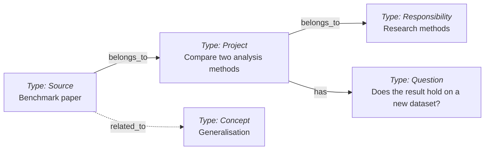
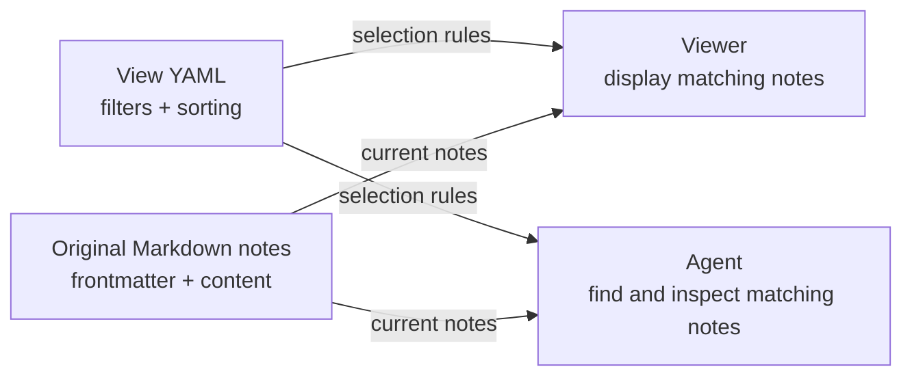
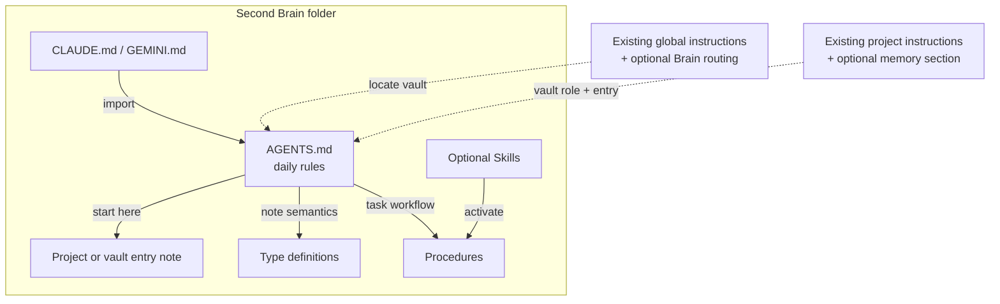

# Second Brain template

A lightweight knowledge base built from **Markdown notes, YAML frontmatter and links**, independent of any AI provider. Your Second Brain is a simple folder of human-readable files that you can copy, back up or move between tools. Its linked notes preserve context, sources and decisions between conversations.

You can use it entirely by hand in any Markdown editor. AI makes capture, retrieval and maintenance much easier: a coding agent with filesystem access can follow the included instructions to read and write the notes. Choose the agent and model provider that suit you. [Tolaria](https://tolaria.md/) offers an optional viewer; keep your existing tools and source documents.

The repository contains note templates, instructions and helper scripts; it installs no applications and enables no scheduled jobs. [Search indexes and RAG](#optional-search-and-memory-layers) can be added on top. Direct file search and graph navigation have been sufficient in the workflows used to develop this template.


Keep this template free of personal or work content, source dumps, credentials, attachments, local roots, caches and generated agent state. Put real knowledge in your own deployed copy.

[How it works](#how-it-works) · [Start here](#start-here) · [Agent instructions](#agent-instructions) · [Responsible use](#responsible-use) · [Note types](#note-types) · [Files and relationships](#files-and-relationships) · [Note lifecycle](#note-lifecycle) · [Saved views](#saved-views) · [Extending the model](#extending-the-model) · [Other tools and formats](#relationship-to-other-tools-and-formats) · [Repository map](#repository-map) · [Licence](#licence)

## How it works

- **Notes are files.** Each `.md` file has readable text and a YAML header, called frontmatter, for structured properties.
- **Types say what a note is.** `type: Project` describes current work; `Source`, `Concept` and `Question` distinguish source material, reusable ideas and unresolved issues. The [Type definitions](#note-types) explain their conventions and can be extended.
- **Relationships say how notes connect.** `belongs_to` names a parent, `has` selects useful entry points, and `related_to` links relevant notes. Body links such as `[[benchmark-paper]]` add context.
- **Agents can read and write the graph.** The template includes [agent instructions](AGENTS.md), Type definitions and Procedures that explain how to find, structure, link and update notes. With filesystem access, coding agents can search metadata, follow links and create or edit notes using these conventions. No graph database or separate retrieval index is required.

You can write notes yourself in any Markdown editor. In practice, it is often easier to tell an agent what you want to remember and let it choose a suitable Type, reuse or update existing notes, and add useful links. For example: “Note this in my brain: for this study, we still need to check whether the results hold on a new dataset.”

For example, a study comparing two analysis methods can link a benchmark paper, an open validation question and the concept of generalisation:



Each box is one note; arrow labels name fields stored in the note they leave. These fictional notes illustrate the model. See the [file example and relationship reference](#files-and-relationships) below for the YAML behind it.

## Start here

### Set it up yourself

1. Create your own private copy in a new folder, using GitHub's template action when available, a clone, or a downloaded copy. Keep the shared template neutral. If you already have a vault, use [Upgrade an Existing Vault](upgrade-existing-vault-from-template.md) to port selected changes while preserving your notes and instructions.
2. Open the folder in your usual Markdown editor. A vault is simply this folder of notes and their operating rules.
3. Give [vault.md](vault.md) a name and purpose, and define the copy's scope and privacy boundary in this README. If you use an agent, customize [AGENTS.md](AGENTS.md) for that same scope and remove its template-only section. Retain the Type definitions you use; pruning the rest can wait.
4. Create one Project and one non-sensitive Source using their [definitions and templates](#note-types). Link them and try finding the Source again from the Project.
5. Use the notes as they are. Add [agent routing](#agent-instructions), Skills, external-file helpers, views or automation only when useful. Keep existing project documentation in its canonical location and link to it.

Basic note use needs a text editor. Git adds history and rollback; the optional [GitHub deployment walkthrough](deploy-vault-from-template.md) uses Git and the GitHub CLI (`gh`). Python 3.10 or later is needed only for the bundled audit/reference helpers, and the optional Skill-link installer uses a POSIX shell.

### Ask an agent to set it up

Open the template with your agent and adapt this request:

```text
Set up a Second Brain in <DESTINATION> for <PURPOSE> using this template.
Read README.md and deploy-vault-from-template.md. Inspect the destination first;
preserve existing content and use the upgrade guide if a vault already exists.
Start with Markdown notes, customize the entry note and vault instructions,
and verify that a Project can lead to a useful linked note.
Keep my existing tools, project documents and instruction files.
For cross-project memory, offer the small global routing block for the runtimes
I select. Inspect existing instructions, preview the diff and preserve a recovery
copy; add or update only the Second Brain section or import. If a generator owns
the instructions, change its source and use its normal regeneration mechanism.
Leave optional Skill installation, services and automation off unless selected.
Report the resulting files, checks and any remaining setup choices.
```

The [deployment guide](deploy-vault-from-template.md) includes the minimal folder route and a more detailed, verifiable GitHub route. It applies integration checks only to the features selected during setup.

Links in this README work on GitHub. Within the vault, `[[project]]` is a wikilink to `project.md`; YAML between `---` lines stores note metadata. [AGENTS.md](AGENTS.md) defines the conventions for agents.

## Responsible use

Set the boundaries once when configuring a vault: which sources it may use, which AI tools and accounts may process them, who may read the notes, where backups live, and how long material should be retained. Keep professional and private content in their appropriate vaults. These choices should reflect your organization's policies and any obligations attached to the source material.

**AI processing.** An agent may send the contents of files it reads to its model provider, even during a read-only task. Choose tools and account settings appropriate for your data, including provider retention and training terms. Use services approved for the material you work with, and keep personal, confidential or otherwise restricted information out of unsuitable tools and storage. Keep credentials out of model prompts and share only the context needed for the task.

**Meetings and other people.** If you use meeting recordings or transcripts, inform participants and obtain their agreement before recording and for the intended transcription, AI processing, retention and sharing. Respect refusals and off-record discussions. Keep notes about people relevant and proportionate, and exclude incidental or overheard conversations. A summary can still contain personal or confidential information.

**Storage and retention.** A private Git repository can still be copied, cloned and shared with collaborators. Keep raw audio, transcript exports, secrets and sensitive source documents outside Git in suitable storage. `.local/` is ignored for machine-local configuration; the credential-file exclusions in `.gitignore` are an additional safeguard, not a content review. Define retention for both sources and summaries, including correction and deletion handling. Removing a note from the current tree does not erase Git history, backups or provider copies. Preserve original captures through an appropriate backup before clearing them; uploading raw material is never a prerequisite for organizing it.

Agree these boundaries during setup and reuse them for routine work. Seek clarification when a new source, tool, destination or action introduces a material new risk or changes the agreed scope. [AGENTS.md](AGENTS.md) carries this operating rule.

## Note types

The template includes all 17 types below; there is no separate type pack to install. You can start by writing only Projects, Sources and general Notes. The other types are available when useful, and some describe the template's own instructions and workflows. Recap is an explicitly optional extension.

| Note | Purpose |
| --- | --- |
| [Note](note.md) | General knowledge that does not yet need a more specific type. |
| [Project](project.md) | Current outcome, state, next actions and links for a finite effort. |
| [Responsibility](responsibility.md) | An ongoing area of ownership. |
| [Operation](operation.md) | A recurring activity, with its cadence and operating state. |
| [Source](source.md) | External material or a maintained file location, with provenance and a useful summary. |
| [Topic](topic.md) | A broad entry point for related notes and questions. |
| [Concept](concept.md) | A reusable idea or method. |
| [Question](question.md) | A consequential unresolved issue worth returning to. |
| [Opinion](opinion.md) | Your current stance, kept distinct from evidence. |
| [Person](person.md) | Relevant relationship, role and collaboration context about someone. |
| [Event](event.md) | A meeting, milestone or other occurrence worth remembering as an event. |
| [Recap](recap.md) | Optional reviewed summaries of discussions and activities over a day, month or year. |
| [Guide](guide.md) | Orientation and reference material, including this README. |
| [Procedure](procedure.md) | How to perform a repeatable workflow. |
| [ADR](adr.md) | A lasting design decision, its rationale, alternatives and consequences. |
| [Skill](skill.md) | The visible catalogue entry for an executable agent Skill package. |
| [Type](type.md) | The definition, metadata and conventions for a category of notes. |

The [Portent model](https://portent.md/types) classifies work along two dimensions: its size and whether it recurs.

| Work | Usually one sitting | Spans several sittings |
| --- | --- | --- |
| One-off | Task | Project |
| Recurring or ongoing | Operation | Responsibility |

This template keeps small tasks in Project action lists or a task manager, so it does not bundle a Task Type. An Operation records that recurring work exists; a Procedure explains how to do it. A Responsibility implies ongoing ownership; a Topic groups knowledge without implying a commitment to maintain an outcome.

Work and knowledge belong in the same graph. Events, Notes, Topics and People provide context for work; this template adds more specific knowledge and system types. A Source preserves provenance; Concepts, Opinions and Project notes hold the useful synthesis. These choices adapt the model rather than claim conformance to every Portent convention.

You do not need to create examples of every type. When pruning a deployment, keep the definitions needed by its retained notes and remove affected links and workflows together.

Projects normally contain 600–1,200 words, concise current state, 3–7 actions, prioritized Questions and Important Notes, and 3–5 milestones. Detailed evidence lives in linked notes. Long reference notes retain their payload and start with a short summary. Agents read progressively from the relevant entry point and inspect evidence before making claims.

## Files and relationships

Each note is one UTF-8 `.md` file. Its YAML header, called *frontmatter*, stores structured metadata; the Markdown body holds the text, headings, lists and source links. The first `#` heading is the display title, so a separate `title:` field is unnecessary. Filenames use kebab-case.

For example, the `benchmark-paper.md` Source from the opening graph might contain:

```markdown
---
type: Source
belongs_to:
  - "[[compare-analysis-methods]]"
related_to:
  - "[[generalisation]]"
url: https://example.org/benchmark-paper
_organized: true
---

# Benchmark paper

A summary of how Method A and Method B were compared, including the datasets,
evaluation criteria and limitations.

Original: [Benchmark paper](https://example.org/benchmark-paper).
See [[compare-analysis-methods|Compare two analysis methods]] for the current study.
```

Here, `type: Source` refers to the definition in [source.md](source.md). `url` is ordinary metadata. `_organized: true` marks a note with a retrieval path. The quoted wikilinks connect it to other notes; these example targets illustrate the syntax and are not bundled notes.

Links in the body connect ideas in context. Relationship fields in the header give those connections an explicit meaning:

| Field | Meaning |
| --- | --- |
| `belongs_to` | Parent project, responsibility or other owning context. |
| `related_to` | A lateral connection to another relevant note. |
| `has` | A selective list of important children or entry points. |
| `surface_for` | Membership in a small human-facing project surface, selected by a saved view. |

Use YAML lists for multiple targets and quote wikilinks. `[[compare-analysis-methods]]` refers to a root filename without `.md`; `[[procedures/ingest-source]]` includes a vault-relative folder path. `[[compare-analysis-methods|Compare two analysis methods]]` supplies a readable label. A `has` list is curated and does not need to repeat every child or backlink.

The [opening graph](#how-it-works) shows a few of these relationships across different note types. It illustrates selected links, not every possible connection or a required hierarchy.

GitHub [renders these Mermaid diagrams directly](https://docs.github.com/en/get-started/writing-on-github/working-with-advanced-formatting/creating-diagrams#creating-mermaid-diagrams). Other editors may show their text source; the surrounding explanations and tables describe the same conventions.

Folders organize files; links and relationships describe their meaning. The [saved views](tolaria-saved-views.md) are separate `.yml` files that select and display existing notes without duplicating their content. Markdown, metadata, links, views and Git remain the durable system independently of the viewer or agent.

## Note lifecycle

Capture and organization are separate activities. Save useful material without first designing perfect metadata, then give it enough structure to find again. The [model's lifecycle](https://tolaria.md/templates/portent#lifecycle) also distinguishes retained history from active knowledge:

| State | Convention in this template |
| --- | --- |
| Captured | `_organized: false` identifies material still awaiting organization. |
| Organized | `_organized: true` means it has a clear title, suitable type and a useful retrieval path, such as a Project link, Topic or view. |
| Archived | `_archived: true` retains a note while excluding it from active views. |

These flags are separate from type-specific workflow fields: a Project can have `status: Active`, and a Question `status: Open`. Completing work does not itself delete its notes. Archive retained inactive material according to the agreed retention policy, keeping useful evidence and provenance retrievable. See [Process Inbox](procedures/process-inbox.md) for the full organization and preservation rules.

Write organized notes directly when their retrieval path is already clear.

## Saved views

A view saves the conditions for a useful recurring question, such as “Which questions are still open?” Its YAML file under `views/` defines filters, sorting and optional display columns. It contains the selection rules, not a stored copy of the results or another note type.



The template includes four examples:

| View | Selection | Example use by an agent |
| --- | --- | --- |
| [Open Questions](views/open-questions.yml) | Unarchived Questions with `status: Open`. | Find questions to review, then read their current answers and evidence. |
| [Evergreen Concepts](views/evergreen-concepts.yml) | Unarchived Concepts with `maturity: Evergreen`. | Find established ideas relevant to a task. |
| [External Raw Sources](views/external-raw-sources.yml) | Unarchived Sources with a `root_key`. | Identify external-file pointers for a reference check. |
| [Vault](views/surface-vault.yml) | Unarchived notes whose `surface_for` includes `"[[vault]]"`. | Find the curated entry points for this vault. |

**For people,** Tolaria renders the matching notes with the chosen sorting and columns. A project's human view is deliberately small, usually 3–5 notes: the Project, current work and a few useful entry points. Not every Project needs one.

**For agents,** a relevant view can provide a reusable starting selection. An agent can read the YAML, find matching notes from their frontmatter with filesystem tools or a script, and inspect the underlying content without opening Tolaria. Filters are useful for narrowing retrieval; icons, colors and columns mainly support presentation.

The file format is Tolaria-specific, and this repository does not bundle a standalone view executor. Reproducing exact results requires matching its filter and derived-field semantics. See the [saved-view reference](tolaria-saved-views.md) for the contract.

Treat a view as a navigation aid within the task's scope. A curated human surface intentionally omits supporting Sources and historical detail; agents should follow Project links, relationships and targeted searches when more evidence is needed. Keep that human surface selective rather than expanding it into an exhaustive agent index. View membership grants no additional access to sources.

## Extending the model

The model is open to extension. Use existing types when they fit, and add structure when it solves a recurring retrieval or workflow need:

- **Add a field:** properties such as `priority`, `review_date` or an external identifier can be added to frontmatter. Document a field's meaning and expected values in the relevant Type or Guide, and use it consistently.
- **Add a relationship:** a field such as `depends_on` can hold quoted wikilinks. Define its direction and purpose while keeping the four established relationships above for their existing meanings.
- **Add a type:** create a root definition such as `organization.md` with `type: Type`, a first heading `# Organization`, and an explanation of when to use it. Notes in that category then use `type: Organization`. Follow the [Type conventions](type.md) and give the definition a retrieval path.
- **Extend a workflow or view:** update the relevant Procedure, Skill or saved-view configuration when the new structure should affect behavior. Adding a field alone does not create automation or guarantee that every application interprets it.

Prefer a property for a small distinction, such as `format: video` on a Source. Create a new Type when it needs a distinct template, relationships or workflow, as the [extension guidance](https://portent.md/implementation/extending-portent) recommends.

Type identities stay in English; `_sidebar_label` can localize their display. Preserve valid custom fields. Keys beginning with `_` are generally viewer or lifecycle metadata and should follow their documented conventions. This template supplies a shared starting model without requiring every vault to have the same domain-specific schema.

## Relationship to other tools and formats

These tools and formats address different parts of a knowledge system and can be combined.

| Approach | What it provides | How this template relates |
| --- | --- | --- |
| [Obsidian](https://help.obsidian.md/Files+and+folders/How+Obsidian+stores+data) | An application for a local folder of Markdown notes, with [properties](https://help.obsidian.md/properties) and [internal links](https://help.obsidian.md/links). | The basic files, YAML and wikilinks are familiar. This template adds particular note types, relationship meanings and maintenance workflows. |
| Wikis, including [LLM-maintained wikis](https://gist.github.com/karpathy/442a6bf555914893e9891c11519de94f) | Linked pages that accumulate and revise knowledge; an LLM wiki uses an agent to maintain synthesis from sources. | Both use linked, maintained knowledge. This template also defines explicit types, project state and relationships, separates sources from synthesis, and supports human or agent maintenance. |
| Google Cloud's [Open Knowledge Format (OKF)](https://github.com/GoogleCloudPlatform/knowledge-catalog/blob/main/okf/SPEC.md) | A format for exchanging knowledge as Markdown files with YAML frontmatter, including a required `type` and extensible metadata. | The basic representation is similar. This template adds its own type definitions, typed relations and operating procedures. |
| [QMD](https://github.com/tobi/qmd) | A local search engine combining keyword search, semantic search and reranking over Markdown files. | Can index the folder as an optional retrieval layer. The notes remain authoritative; the index needs refreshing as files change. |
| Garry Tan's [GBrain](https://github.com/garrytan/gbrain) | A broader agent-memory system with keyword and optional semantic retrieval, graph navigation, synthesis and agent integrations. | Selected retrieval features could complement the notes through a separate integration. It has its own storage and conventions; this template includes no ready-made connector. |

You can open the notes in Obsidian, but the template does not bundle an Obsidian configuration or plugins. Its type meanings and Tolaria saved views do not automatically become equivalent Obsidian behavior; configure the views and workflows you want in your chosen application.

The LLM-wiki pattern emphasizes a maintained knowledge layer between sources and answers. Here, the same principle extends to current work, decisions and responsibilities, with explicit write authority and external-file boundaries. Sources can remain in their canonical systems rather than being copied into a `raw/` folder.

OKF specifies standard Markdown cross-links and its own lifecycle and provenance conventions. This template uses wikilinks for its typed graph and type-specific status values. Unknown types and extra fields are allowed by OKF, but equivalent graph and lifecycle behavior needs an explicit mapping. This repository makes no OKF conformance claim and does not require Google services. See the [OKF specification](https://github.com/GoogleCloudPlatform/knowledge-catalog/blob/main/okf/SPEC.md) before relying on interchange with a particular consumer.

### Optional search and memory layers

Retrieval-augmented generation (RAG) supplies a model with relevant material retrieved for a task. Many implementations build a separate search index, often using text chunks and embeddings. This template's default path is direct file search and graph navigation: start from an entry note, inspect metadata and follow useful links. The relationships already exist in the Markdown files.

In the workflows used to develop this template, trials of QMD and GBrain did not show enough additional benefit to justify maintaining an extra retrieval stack. We therefore keep the default setup free of a separate index. The value of indexing depends on the workload; it may help when fuzzy recall or poorly connected material repeatedly defeats direct retrieval.

You can add a search layer over the same files, or integrate a broader memory system, when it solves a concrete need. QMD can index a Markdown folder; a GBrain integration also needs to account for its storage, relationship and writeback conventions. Keep the notes as the durable source of truth, make derived indexes rebuildable, and verify retrieved snippets against the underlying notes. These are optional extensions, not bundled integrations.

## Everyday use

- Save ambiguous captures in unprocessed notes and use [Process Inbox](procedures/process-inbox.md). Put material explicitly ready for processing in [Ready To Ingest](ready-to-ingest.md), following [Process Ready Ingestion Inbox](procedures/process-ready-ingestion-inbox.md).
- Add a paper, webpage or document through [Ingest Source](procedures/ingest-source.md), preserving provenance and linking useful conclusions to existing work.
- Resume from a Project or Responsibility. Use [Update Project Summary](procedures/update-project-summary.md) and [Update Project Next Actions](procedures/update-project-next-actions.md) to reconcile current state.
- Use small project views through [Maintain Project Human View](procedures/maintain-project-human-view.md). See the [saved-view reference](tolaria-saved-views.md), [starter views](views/) and [callout guide](tolaria-callouts.md) when needed.
- Diagnose structure with [Lint Vault](procedures/lint-vault.md) and usefulness with [Review Vault Health](procedures/review-vault-health.md).

A Brain Project does not require a matching folder or agent-application project. [Route Project Work And Artifacts](procedures/route-project-work-and-artifacts.md) defines when a technical workspace is justified and the cloud `Working/` fallback. [Initialize Project Memory](procedures/initialize-project-memory.md) connects an existing workspace through a small memory section in its instruction file, preserving its technical guidance. The added pointer is normally about 80 words; that is not a limit on the existing file.

[Recaps](recap.md) are an optional way to retain reviewed discussions and activities by day, month or year. The [preparation procedure](procedures/prepare-recording-recaps.md) can use selected meeting notes, transcripts or recordings. Configure its source scope, review and retention first. You can omit the Recap Type, Procedure, [Capture Preferences](capture-preferences.md) and their links together.

## Agent instructions

The vault files are instructions for daily work after deployment. Setup guides explain how to customize and connect them:



| Layer | Purpose and installation |
| --- | --- |
| Vault [AGENTS.md](AGENTS.md) | Daily retrieval, note and workflow rules for this Brain. Customize it in your copy; it stays in the vault. |
| Vault [CLAUDE.md](CLAUDE.md) and [GEMINI.md](GEMINI.md) | Small compatibility files importing `AGENTS.md`. Keep shared rules in that one file and preserve any existing runtime-specific instructions when adding an import. |
| Machine-global instructions | An optional, small routing block so an agent working elsewhere can find the Brain. Add it only to the selected runtimes through [Configure Global Agent Instructions](procedures/configure-global-agent-instructions.md). |
| Existing project's instruction file | An optional memory section naming the relevant vault role and entry note. Add it alongside the project's existing technical instructions through [Initialize Project Memory](procedures/initialize-project-memory.md). |
| Skills | Optional workflow shortcuts from `.agents/skills/`. Their discovery is separate from instruction loading; see [Configure Agent Skill Discovery](procedures/configure-agent-skill-discovery.md). |

Working inside the Brain uses its local instruction files through the runtime's supported loading mechanism. Global routing is useful when working from other folders; manual note use needs no global installation. The [global instruction template](global-agent-instructions-template.md) contains only the marked block to add, not a replacement global file.

Default user files are `~/.codex/AGENTS.md` for Codex, `~/.claude/CLAUDE.md` for Claude Code and `~/.gemini/GEMINI.md` for Gemini CLI. Existing overrides, custom configuration paths or a generator may change the active source; confirm it through the setup Procedure before editing.

**Preserve existing instructions.** Inspect the destination first, preview the diff and keep a recovery copy outside the vault. Add or update only the Second Brain block or import, leaving unrelated content in place. An existing generated configuration keeps its own source and regeneration mechanism. A repeat installation should update the same block rather than append a duplicate; resolve real conflicts during setup and reuse that decision for routine work.

Instruction generation is optional configuration infrastructure. This template maintains one vault `AGENTS.md` and two small import files. It does not include a generator for machine-global instructions. `scripts/configure-agent-skills.sh` only links Skill packages; it does not install or generate instruction files.

The [Skill installer](scripts/configure-agent-skills.sh) supports Codex, Claude Code and an explicit documented directory for other compatible runtimes. Prune unwanted packages first: it links every retained package, preflights the full target and never overwrites conflicts. Links are machine-local and stay out of Git. Do not guess another runtime's discovery path; Procedures remain usable when automatic Skill discovery is unavailable.

The [visible Skill catalogue](skills/) and [canonical packages](.agents/skills/) describe ownership. Procedure-backed packages require the complete Procedure, which wins on conflict. Thin wrappers must preserve triggers, prerequisites, guards, commands and support-file instructions. A specialized package may own execution when no Procedure does, with that ownership explicit in its catalogue. Add a Skill only when repeated use makes discovery useful.

## External files and optional automation

Keep maintained external folders in their canonical storage. Choose one default file strategy during deployment: `convention-based` derives a folder from an external root and project slug; `linked-per-project` confirms each project's distinct folder; `workspace-only` permits durable non-versioned files only after an explicit external location is added.

A [Source](source.md) points to maintained inputs, outputs or deliverables with `storage_system`, `root_key`, `relative_path`, `access` and `last_checked`. Local roots resolve through ignored `.local/roots.yml`. `access: guarded-write` permits external writes only when the user authorizes that specific action. The [reference checker](procedures/check-external-raw-references.md) verifies paths within their configured roots.

Disable `attachments/` or reserve it for small, intentional Git-tracked vault assets. Keep durable non-versioned work in the configured external location, or `Working/<project-or-context-slug>/` before a dedicated folder is justified. Use an ignored workspace `.tmp/` for reproducible or disposable intermediates and `/tmp/` for truly disposable files.

[Vault Automations](vault-automations.md) documents optional jobs. Begin manually; configured jobs use their own vault's working directory, privacy rules and approved model. Read-only jobs never edit or checkpoint; write-capable jobs need narrow scope and separate push authority.

[Review Multi-Vault Consistency](procedures/review-multi-vault-consistency.md) belongs only in an explicitly designated routing/control vault. Ordinary deployments remove its installed Skill package and active routes; they may retain the Procedure as clearly archived provenance. This template does not authorize access to another vault's private content.

## Review and backup

Follow [Git Checkpoint Vault Changes](procedures/git-checkpoint-vault-changes.md): preserve unrelated edits, review and stage only the authorized scope, and distinguish a local commit from permission to push. Never force-push without explicit approval. Review content before it enters Git, including filenames and metadata; keep the template itself neutral and content-free.

## Repository map

The repository includes a working skeleton and its maintenance instructions. You do not need to read every file before starting or retain every optional feature in a deployed vault.

| Files | Role |
| --- | --- |
| [vault.md](vault.md), [maintain-vault.md](maintain-vault.md), [ready-to-ingest.md](ready-to-ingest.md) | Starter entry Project, maintenance Responsibility and ready-marked intake note. Replace their placeholders and add real content in your copy. |
| Root Type definitions | The 17 [types listed above](#note-types), including their templates and conventions. These define categories; they are not examples of completed work. |
| [AGENTS.md](AGENTS.md), [CLAUDE.md](CLAUDE.md), [GEMINI.md](GEMINI.md) | Vault operating rules and small compatibility files that import those rules for other runtimes. |
| [Deployment](deploy-vault-from-template.md), [upgrade](upgrade-existing-vault-from-template.md) and [global instruction template](global-agent-instructions-template.md) | Bootstrap and configuration material, to customize or retire after setup. |
| [procedures/](procedures/) | Complete workflows for ingestion, project upkeep, validation, configuration and checkpointing. |
| [skills/](skills/) and [.agents/skills/](.agents/skills/) | Human-readable Skill catalogue and matching executable packages. `SKILL.md` routes an agent to its Procedure; optional `agents/openai.yaml` files supply Codex UI metadata. |
| Package `scripts/` and `references/` | External-reference checking and its regression tests, compactness and icon audits, and a reproducible MIT-licensed Phosphor icon-name list. These support the relevant Procedures. |
| [scripts/configure-agent-skills.sh](scripts/configure-agent-skills.sh) | Installs or checks machine-local links to retained Skill packages. |
| [views/](views/), [saved-view reference](tolaria-saved-views.md), [callout reference](tolaria-callouts.md) | Optional saved selections and viewer presentation guidance. |
| [Vault Automations](vault-automations.md), [Capture Preferences](capture-preferences.md) | Optional configuration guides; neither activates a job or source connection. |
| [adr/](adr/) and short Concept notes | The starter portability decision and a small glossary of design choices, described below. |
| [assets/second-brain-overview.png](assets/second-brain-overview.png) | README illustration of the portable folder and the manual and agent-assisted ways to use it. |
| [.gitignore](.gitignore) | Exclusions for local configuration, temporary files and common credential files. |
| [LICENSE](LICENSE), [THIRD_PARTY_NOTICES.txt](THIRD_PARTY_NOTICES.txt) | MIT terms for the template and retained upstream notices. |

The short Concepts explain [the system](second-brain-system.md), [tool independence](agent-neutral-vault-definition.md), [capture first](capture-first-workflow.md), [project memory](project-scoped-memory.md), [sources and synthesis](source-note-vs-synthesis-note.md), [agent-executed Procedures](agent-executed-procedure.md) and [Agent Skills](agent-skill.md). They are lightweight linked examples, not prerequisites. Keep them when useful for onboarding, or prune them and their links during deployment.

## Licence

The template, its documentation and helper scripts are available under the [MIT licence](LICENSE). Retain the applicable [third-party notices](THIRD_PARTY_NOTICES.txt) for the Portent material and the Phosphor icon-name list. The latter is only an offline text list for the optional icon checker; it contains no icon images or application code.

Material you later add to a deployed vault has its own ownership, confidentiality and licensing. Using this template grants no permission to disclose or relicense that material.
