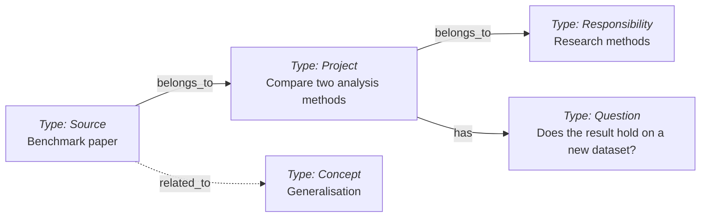

# Second Brain template

A knowledge base made of **Markdown notes, YAML frontmatter and links**, independent of any AI provider: a folder of readable files you can copy, back up or move between tools, whose linked notes keep context, sources and decisions between conversations. You can use it by hand in any Markdown editor; a coding agent with filesystem access makes capture, retrieval and maintenance much easier. [Tolaria](https://tolaria.md/) offers an optional viewer, and [Brain Graph](https://github.com/mfoll/brain-graph) (a companion repository) draws the whole vault as an interactive map coloured by the Responsibility or Project each note rolls up to; it is how the hierarchy contract below was first seen. The repository installs no applications, enables no scheduled jobs and needs no search index.


## What it adds to Portent

This template adapts the [Portent Vault Template](https://github.com/refactoringhq/portent-vault-template) and builds on [Portent](https://github.com/refactoringhq/portent), Refactoring’s open specification for portable knowledge bases. Portent supplies the vocabulary: the core types, relationships and lifecycle. This repository adds what an agent needs to operate a vault for months without the structure drifting:

- **Operating rules.** [AGENTS.md](AGENTS.md) is the vault's constitution, with three instruction layers (global, vault, project pointer) and explicit write, provenance and external-file boundaries.
- **Workflows and packages.** Sixteen [Procedures](procedures/) for ingestion, inbox processing, project upkeep, validation and checkpointing. The seven most frequent are also exposed as thin [Skill packages](.agents/skills/) that point an agent to the Procedure rather than repeat it; [Agent Setup](agent-setup.md#why-skills-are-thin) explains why.
- **A decision record.** Eleven [ADRs](adr/) explain why the structure is the way it is, with the alternatives rejected and the signal that would reopen each decision, so that an agent does not relax a rule in the first ambiguous case. They are listed [below](#design-decisions).
- **Enforcement.** Lint scripts audit compactness, icon names and the `belongs_to` hierarchy, and the health review turns their findings into promotion proposals. The hierarchy contract fills the one gap Portent leaves open: every durable note rolls up to a Responsibility, Topics stay lateral, and a note has a named home before it has a project.

These additions were worked out on a real professional vault, in daily use with agents since April 2026, and ported back once they proved generic. Conventions still change; each change lands as an ADR.

[How it works](#how-it-works) · [Start here](#start-here) · [A worked session](#a-worked-session) · [Example vaults](#example-vaults) · [Design decisions](#design-decisions) · [Responsible use](#responsible-use) · [Everyday use](#everyday-use) · [Other tools](#relationship-to-other-tools) · [Repository map](#repository-map) · [Licence](#licence)

Reference material lives in two Guides: the [Model Reference](model-reference.md) (types, file format, relationships, lifecycle, views, extending the model, interoperability) and [Agent Setup](agent-setup.md) (instruction layers, Skills, audits, external files, automation, checkpointing).

## How it works

- **Notes are files.** Each `.md` file has readable text and a YAML header, called frontmatter, for structured properties.
- **Types say what a note is.** `type: Project` describes current work; `Source`, `Concept` and `Question` distinguish source material, reusable ideas and unresolved issues. The 17 [Type definitions](model-reference.md#note-types) explain their conventions and can be extended.
- **Relationships say how notes connect.** `belongs_to` names the parent, `has` selects useful entry points, and `related_to` links relevant notes. Body links add context.
- **Agents can read and write the graph.** With filesystem access, a coding agent follows the instructions, Type definitions and Procedures to find, structure, link and update notes. No graph database or separate retrieval index is required.

A study comparing two analysis methods can link a benchmark paper, an open validation question and the concept of generalisation:



Each box is one note; arrow labels name fields stored in the note they leave. These fictional notes illustrate the model; the [Model Reference](model-reference.md#files-and-relationships) shows the YAML behind them.

## Start here

To see what a vault looks like after two years of use before building your own, clone one of the [example vaults](#example-vaults) and open it in any Markdown editor, [Tolaria](https://tolaria.md/) or [Brain Graph](https://github.com/mfoll/brain-graph).

1. Create your own private copy in a new folder, using GitHub's template action, a clone, or a downloaded copy; include the hidden `.agents/` folder and `.gitignore`, which some copy tools skip, but not a clone's `.git` folder, which would carry the template's remote. Keep the shared template neutral. If you already have a vault, use [Upgrade an Existing Vault](upgrade-existing-vault-from-template.md) to port selected changes while preserving your notes and instructions.
2. Open the folder in your usual Markdown editor. A vault is simply this folder of notes and their operating rules.
3. Give [vault.md](vault.md) a name and purpose, then replace this README with the short vault README from the [deployment guide](deploy-vault-from-template.md), which records the copy's scope and privacy boundary once. If you use an agent, customize [AGENTS.md](AGENTS.md) for that same scope and remove its template-only section.
4. Create one Responsibility for your area of work, one Project under it and one non-sensitive Source under the Project, using their definitions and templates. Try finding the Source again from the Project.
5. Use the notes as they are. Add [agent routing](agent-setup.md), Skills, external-file helpers, views or automation only when useful. Keep existing project documentation in its canonical location and link to it.

Basic note use needs a text editor. Git adds history and rollback; the optional [GitHub deployment walkthrough](deploy-vault-from-template.md) uses Git and the GitHub CLI. Python 3.9 or later is needed only for the bundled audit helpers, which work in a plain folder as well as in a Git repository; the Python that ships with macOS is enough.

Or open the template with your agent and adapt this request:

```text
Set up a Second Brain in <DESTINATION> for <PURPOSE> using this template.
Read README.md and deploy-vault-from-template.md. Inspect the destination first;
preserve existing content and use the upgrade guide if a vault already exists.
Start with Markdown notes, customize the entry note and vault instructions,
and verify that a Project can lead to a useful linked note.
Keep my existing tools, project documents and instruction files.
For cross-project memory, offer the small global routing block for the runtimes
I select. Inspect existing instructions, preview the diff and preserve a recovery
copy; add or update only the Second Brain section or import.
Leave optional Skill installation, services and automation off unless selected.
Report the resulting files, checks and any remaining setup choices.
```

## A worked session

What the operating rules look like in use, on the fictional study above:

```text
You:   Note this in my brain: the benchmark paper shows Method B generalises
       worse than A on small datasets. We still need to test on a new dataset
       before the study concludes.

Agent: Created Source benchmark-paper under Project compare-analysis-methods,
       with the URL as provenance and a lateral link to Concept generalisation.
       Opened Question does-the-result-hold-on-a-new-dataset (status: Open) and
       listed it under the Project's Open Questions. Replaced the Project's
       Current State bullet on the comparison and added one Next Action.
       Lint: no new findings.
```

Behind that reply: [Ingest Source](procedures/ingest-source.md) chose the Source type and the parent, the hierarchy rule placed the note under the Project that answers for it, the [Project contract](project.md) made the agent reconcile Current State instead of appending a dated line, and [Lint Vault](procedures/lint-vault.md) confirmed the graph still resolves. Nothing was published or sent to anyone; the agent's model provider did receive the text it read, which is why the responsible-use boundaries below are agreed once before the first session. The note stays a file you can edit.

## Example vaults

Nine demo vaults show the template after about two years of fictional daily use, each with 500 to 800 linked notes, a lived-in Git history and a guided tour with questions that have known answers. Everything about the people and organisations is invented; the literature they cite is real. Clone one and open the folder.

| Vault | Whose memory |
| --- | --- |
| [Varga Lab Brain](https://github.com/mfoll/second-brain-demo-cancer-lab) | A group leader running a cancer genomics and molecular epidemiology lab |
| [Hollowgate Bakehouse Brain](https://github.com/mfoll/second-brain-demo-cafe) | The owner of an independent café and bakery |
| [Marchbank Teaching Brain](https://github.com/mfoll/second-brain-demo-teacher) | A secondary-school history teacher and head of year |
| [Brennick Design Brain](https://github.com/mfoll/second-brain-demo-freelancer) | A freelance product designer |
| [Brierly Household Brain](https://github.com/mfoll/second-brain-demo-household) | A parent keeping a family's home, care, school and money records |
| [Fernhollow Club Brain](https://github.com/mfoll/second-brain-demo-community-club) | The volunteer chair of a neighbourhood sports and youth club |
| [Quayle Writing Brain](https://github.com/mfoll/second-brain-demo-novelist) | A novelist writing her second book |
| [Arneberg Engineering Brain](https://github.com/mfoll/second-brain-demo-startup) | The engineering lead of a small software start-up |
| [Castellane HR Brain](https://github.com/mfoll/second-brain-demo-hr-assistant) | An HR assistant in a large company |

## Design decisions

The eleven ADRs, one line each. Each records its context, the options rejected and the signal that would reopen it.

1. [Treat the Markdown graph as the portable brain](adr/0001-treat-markdown-graph-as-portable-brain.md): notes, frontmatter, links and Git are the system; viewers and agents are replaceable.
2. [Project-scoped memory](adr/0002-use-project-scoped-memory-for-agent-workspaces.md): a workspace points to one Project note through a compact memory section, and agents start there.
3. [Record vault decisions as ADRs](adr/0003-use-adrs-for-vault-design-decisions.md), superseding rather than rewriting.
4. [Hybrid layout](adr/0004-use-hybrid-layout-with-frontmatter-as-semantic-source.md): core notes and Types at the root, ADRs, Procedures and views in folders; frontmatter is the semantic source.
5. [One Source type](adr/0005-use-source-as-single-external-ingestion-type.md) for all external material, with provenance fields.
6. [Active subprojects get their own Project note](adr/0006-use-project-notes-for-active-subprojects.md) under an umbrella.
7. [Compact front page](adr/0007-keep-hot-path-memory-compact-and-single-sourced.md): Projects stay 600–1,200 words with linked detail.
8. [Semantic reachability and reversible compaction](adr/0008-require-semantic-reachability-and-reversible-compaction.md): nothing is trimmed until its payload has a verified home.
9. [Skill packages](adr/0009-support-procedure-backed-and-specialized-skill-packages.md) are vault-owned and catalogued, either Procedure-backed or explicitly standalone.
10. [A Project note implies no folder](adr/0010-decouple-brain-projects-from-local-workspaces.md): promote to a workspace only past a stated threshold.
11. [`belongs_to` roots at Responsibilities](adr/0011-root-belongs-to-at-responsibilities-and-home-exploration-clusters-in-topics.md): Topics stay lateral, and exploration clusters have a home before a project.

## Responsible use

Set the boundaries once when configuring a vault: which sources it may use, which AI tools and accounts may process them, who may read the notes, where backups live, and how long material should be retained. Keep professional and private content in their appropriate vaults. These choices should reflect your organization's policies and any obligations attached to the source material.

**AI processing.** An agent may send the contents of files it reads to its model provider, even during a read-only task. Choose tools and account settings appropriate for your data, including provider retention and training terms. Use services approved for the material you work with, and keep personal, confidential or otherwise restricted information out of unsuitable tools and storage. Keep credentials out of model prompts and share only the context needed for the task.

**Meetings and other people.** If you use meeting recordings or transcripts, inform participants and obtain their agreement before recording and for the intended transcription, AI processing, retention and sharing. Respect refusals and off-record discussions. Keep notes about people relevant and proportionate, and exclude incidental or overheard conversations. A summary can still contain personal or confidential information.

**Storage and retention.** A private Git repository can still be copied, cloned and shared with collaborators. Keep raw audio, transcript exports, secrets and sensitive source documents outside Git in suitable storage. `.local/` is ignored for machine-local configuration; the credential-file exclusions in `.gitignore` are an additional safeguard, not a content review. Define retention for both sources and summaries, including correction and deletion handling. Removing a note from the current tree does not erase Git history, backups or provider copies. Preserve original captures through an appropriate backup before clearing them; uploading raw material is never a prerequisite for organizing it.

Agree these boundaries during setup and reuse them for routine work. Seek clarification when a new source, tool, destination or action introduces a material new risk or changes the agreed scope. [AGENTS.md](AGENTS.md) carries this operating rule. Keep this template free of personal or work content, source dumps, credentials, attachments, local roots, caches and generated agent state; put real knowledge in your own deployed copy.

## Everyday use

- Save ambiguous captures as unprocessed notes and use [Process Inbox](procedures/process-inbox.md); put material explicitly ready for processing in [Ready To Ingest](ready-to-ingest.md).
- Add a paper, webpage or document through [Ingest Source](procedures/ingest-source.md), preserving provenance and linking useful conclusions to existing work.
- Resume from a Project or Responsibility, and reconcile current state with [Update Project Summary](procedures/update-project-summary.md) and [Update Project Next Actions](procedures/update-project-next-actions.md).
- Diagnose structure with [Lint Vault](procedures/lint-vault.md) and usefulness with [Review Vault Health](procedures/review-vault-health.md); the four audit commands are in [Agent Setup](agent-setup.md#checks-that-keep-the-structure-honest).
- A Brain Project does not require a matching folder or agent-application project; [Route Project Work And Artifacts](procedures/route-project-work-and-artifacts.md) says when a workspace is justified, and [Initialize Project Memory](procedures/initialize-project-memory.md) connects one through a small memory section.
- [Recaps](recap.md) are an optional way to retain reviewed discussions by day, month or year; configure their source scope, review and retention first, or omit the extension entirely.

## Relationship to other tools

These tools and formats address different parts of a knowledge system and can be combined; the [Model Reference](model-reference.md#interoperability) has the detail.

| Approach | What it provides | How this template relates |
| --- | --- | --- |
| [Portent](https://github.com/refactoringhq/portent) and its [vault template](https://github.com/refactoringhq/portent-vault-template) | The core work/knowledge types, relationships and lifecycle, plus starter Markdown Type definitions. | **The foundation of this template.** This repository adapts the starter definitions and adds specialised types, agent operating rules, maintenance workflows, a decision record whose rules are checked by lint, and additive setup guidance. |
| [Obsidian](https://help.obsidian.md/Files+and+folders/How+Obsidian+stores+data) | An application for a local folder of Markdown notes, with properties and internal links. | The files, YAML and wikilinks are familiar. This template adds particular note types, relationship meanings and maintenance workflows; it bundles no Obsidian configuration. |
| Wikis, including [LLM-maintained wikis](https://gist.github.com/karpathy/442a6bf555914893e9891c11519de94f) | Linked pages that accumulate and revise knowledge; an LLM wiki uses an agent to maintain synthesis from sources. | Both use linked, maintained knowledge. This template also defines explicit types, project state and relationships, separates sources from synthesis, and supports human or agent maintenance. |
| Google Cloud's [Open Knowledge Format (OKF)](https://github.com/GoogleCloudPlatform/knowledge-catalog/blob/main/okf/SPEC.md) | A format for exchanging knowledge as Markdown files with YAML frontmatter, including a required `type` and extensible metadata. | The basic representation is similar. This template adds its own type definitions, typed relations and operating procedures, and makes no OKF conformance claim. |
| [QMD](https://github.com/tobi/qmd) | A local search engine combining keyword search, semantic search and reranking over Markdown files. | Can index the folder as an optional retrieval layer. The notes remain authoritative; the index needs refreshing as files change. |
| Garry Tan's [GBrain](https://github.com/garrytan/gbrain) | A broader agent-memory system with keyword and optional semantic retrieval, graph navigation, synthesis and agent integrations. | Selected retrieval features could complement the notes through a separate integration. It has its own storage and conventions; this template includes no ready-made connector. |

## Repository map

You do not need to read every file before starting or retain every optional feature in a deployed vault.

| Files | Role |
| --- | --- |
| [vault.md](vault.md), [maintain-vault.md](maintain-vault.md), [ready-to-ingest.md](ready-to-ingest.md) | Starter entry Project, maintenance Responsibility and ready-marked intake note. Replace their placeholders in your copy. |
| Root Type definitions | The 17 types, including their templates and conventions. |
| [AGENTS.md](AGENTS.md), [CLAUDE.md](CLAUDE.md), [GEMINI.md](GEMINI.md) | Vault operating rules and small compatibility files that import them for other runtimes. |
| [Model Reference](model-reference.md), [Agent Setup](agent-setup.md) | The two reference Guides behind this README. |
| [Deployment](deploy-vault-from-template.md), [upgrade](upgrade-existing-vault-from-template.md) and [global instruction template](global-agent-instructions-template.md) | Bootstrap and configuration material, to customize or retire after setup. |
| [procedures/](procedures/) | Complete workflows for ingestion, project upkeep, validation, configuration and checkpointing. |
| [skills/](skills/) and [.agents/skills/](.agents/skills/) | Human-readable Skill catalogue and matching executable packages, including the compactness, icon, hierarchy and link audits. The seven packages are a starter selection. |
| [scripts/configure-agent-skills.sh](scripts/configure-agent-skills.sh) | Installs or checks machine-local links to retained Skill packages. |
| [scripts/check_external_raw_references.py](scripts/check_external_raw_references.py) | Checker and unit test for [Check External Raw References](procedures/check-external-raw-references.md). |
| [views/](views/), [saved-view reference](tolaria-saved-views.md), [callout reference](tolaria-callouts.md) | Optional saved selections and viewer presentation guidance. |
| [Vault Automations](vault-automations.md), [Capture Preferences](capture-preferences.md) | Optional configuration guides; neither activates a job or source connection. |
| [Example vaults](#example-vaults) | Nine separate repositories, `second-brain-demo-*`: fictional vaults deployed from this template, each with 500 to 800 notes, a guided tour and deliberate lint findings. |
| [Brain Graph](https://github.com/mfoll/brain-graph) | Separate companion repository: an interactive graph viewer for a vault built this way, reading `belongs_to`, `has` and `related_to` directly from the files. Optional. |
| [adr/](adr/) and short Concept notes | The eleven design decisions above and a small glossary: [the system](second-brain-system.md), [tool independence](agent-neutral-vault-definition.md), [capture first](capture-first-workflow.md), [project memory](project-scoped-memory.md), [sources and synthesis](source-note-vs-synthesis-note.md), [agent-executed Procedures](agent-executed-procedure.md), [Agent Skills](agent-skill.md). |
| [.gitignore](.gitignore), [LICENSE](LICENSE), [THIRD_PARTY_NOTICES.txt](THIRD_PARTY_NOTICES.txt) | Exclusions for local configuration and credentials; MIT terms and retained upstream notices. |

## Licence

The template, its documentation and helper scripts are available under the [MIT licence](LICENSE). Retain the applicable [third-party notices](THIRD_PARTY_NOTICES.txt) for the Portent material and the Phosphor icon-name list, an offline text list for the optional icon checker that contains no icon images or application code.

Material you later add to a deployed vault has its own ownership, confidentiality and licensing. Using this template grants no permission to disclose or relicense that material.
