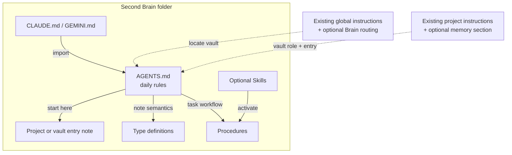

# Agent Setup

How agents find and operate a deployed vault: the instruction layers, Skill packages, external-file conventions, optional automation and checkpointing. Read [[README]] first for what the template is and how to start; use [[deploy-vault-from-template]] for the step-by-step deployment and this note for the operating setup that follows it.

## Agent instructions

The vault files are instructions for daily work after deployment. Setup guides explain how to customize and connect them:



| Layer | Purpose and installation |
| --- | --- |
| Vault `AGENTS.md` | Daily retrieval, note and workflow rules for this Brain. Customize it in your copy; it stays in the vault. |
| Vault `CLAUDE.md` and `GEMINI.md` | Small compatibility files importing `AGENTS.md`. Keep shared rules in that one file and preserve any existing runtime-specific instructions when adding an import. |
| Machine-global instructions | An optional, small routing block so an agent working elsewhere can find the Brain. Add it only to the selected runtimes through [[procedures/configure-global-agent-instructions|Configure Global Agent Instructions]]. |
| Existing project's instruction file | An optional memory section naming the relevant vault role and entry note. Add it alongside the project's existing technical instructions through [[procedures/initialize-project-memory|Initialize Project Memory]]. |
| Skills | Optional workflow shortcuts from `.agents/skills/`. Their discovery is separate from instruction loading; see [[procedures/configure-agent-skill-discovery|Configure Agent Skill Discovery]]. |

Working inside the Brain uses its local instruction files through the runtime's supported loading mechanism. Global routing is useful when working from other folders; manual note use needs no global installation. The [[global-agent-instructions-template|global instruction template]] contains only the marked block to add, not a replacement global file.

Default user files are `~/.codex/AGENTS.md` for Codex, `~/.claude/CLAUDE.md` for Claude Code and `~/.gemini/GEMINI.md` for Gemini CLI. Existing overrides, custom configuration paths or a generator may change the active source; confirm it through the setup Procedure before editing.

**Preserve existing instructions.** Inspect the destination first, preview the diff and keep a recovery copy outside the vault. Add or update only the Second Brain block or import, leaving unrelated content in place. An existing generated configuration keeps its own source and regeneration mechanism. A repeat installation should update the same block rather than append a duplicate; resolve real conflicts during setup and reuse that decision for routine work.

Instruction generation is optional configuration infrastructure. This template maintains one vault `AGENTS.md` and two small import files. It does not include a generator for machine-global instructions. `scripts/configure-agent-skills.sh` only links Skill packages; it does not install or generate instruction files.

## Skill packages

The Skill installer, `scripts/configure-agent-skills.sh`, supports Codex, Claude Code and an explicit documented directory for other compatible runtimes. Prune unwanted packages first: it links every retained package, preflights the full target and never overwrites conflicts. Links are machine-local and stay out of Git. Do not guess another runtime's discovery path; Procedures remain usable when automatic Skill discovery is unavailable.

The visible Skill catalogue under `skills/` and the canonical packages under `.agents/skills/` describe ownership. Procedure-backed packages require the complete Procedure, which wins on conflict. Thin wrappers must preserve triggers, prerequisites, guards, commands and support-file instructions. A specialized package may own execution when no Procedure does, with that ownership explicit in its catalogue. Add a Skill only when repeated use makes discovery useful. [[adr/0009-support-procedure-backed-and-specialized-skill-packages|ADR 0009]] records the two ownership modes.

## Checks that keep the structure honest

Three read-only helpers in `.agents/skills/lint-vault/scripts/` support [[procedures/lint-vault|Lint Vault]] and [[procedures/review-vault-health|Review Vault Health]]:

```bash
python3 .agents/skills/lint-vault/scripts/compactness_audit.py .
python3 .agents/skills/lint-vault/scripts/tolaria_icon_audit.py .
python3 .agents/skills/lint-vault/scripts/hierarchy_audit.py . --tree
```

The compactness audit warns when Projects, Current State sections, Maintenance Logs, Questions or automatically loaded instructions exceed their targets. The icon audit checks configured icon names against the pinned Phosphor list. The hierarchy audit lists Projects without a parent or under a Topic, notes whose `belongs_to` chain reaches no Responsibility, notes reachable only through `has`, double parents, non-hub notes acting as parents, and `related_to`-only clusters ready for promotion; deliberate exceptions are declared with `hierarchy_root: true` and `accepted_double_parent: true` in frontmatter. All three need only Python 3.10 or later with the standard library.

## External files and optional automation

Keep maintained external folders in their canonical storage. Choose one default file strategy during deployment: `convention-based` derives a folder from an external root and project slug; `linked-per-project` confirms each project's distinct folder; `workspace-only` permits durable non-versioned files only after an explicit external location is added.

A [[source|Source]] points to maintained inputs, outputs or deliverables with `storage_system`, `root_key`, `relative_path`, `access` and `last_checked`. Local roots resolve through ignored `.local/roots.yml`. `access: guarded-write` permits external writes only when the user authorizes that specific action. [[procedures/check-external-raw-references|Check External Raw References]] verifies paths within their configured roots.

Disable `attachments/` or reserve it for small, intentional Git-tracked vault assets. Keep durable non-versioned work in the configured external location, or `Working/<project-or-context-slug>/` before a dedicated folder is justified. Use an ignored workspace `.tmp/` for reproducible or disposable intermediates and `/tmp/` for truly disposable files.

[[vault-automations|Vault Automations]] documents optional jobs. Begin manually; configured jobs use their own vault's working directory, privacy rules and approved model. Read-only jobs never edit or checkpoint; write-capable jobs need narrow scope and separate push authority.

[[procedures/review-multi-vault-consistency|Review Multi-Vault Consistency]] belongs only in an explicitly designated routing/control vault. Ordinary deployments remove its installed Skill package and active routes; they may retain the Procedure as clearly archived provenance. This template does not authorize access to another vault's private content.

## Review and backup

Follow [[procedures/git-checkpoint-vault-changes|Git Checkpoint Vault Changes]]: preserve unrelated edits, review and stage only the authorized scope, and distinguish a local commit from permission to push. Never force-push without explicit approval. Review content before it enters Git, including filenames and metadata; keep the template itself neutral and content-free.
