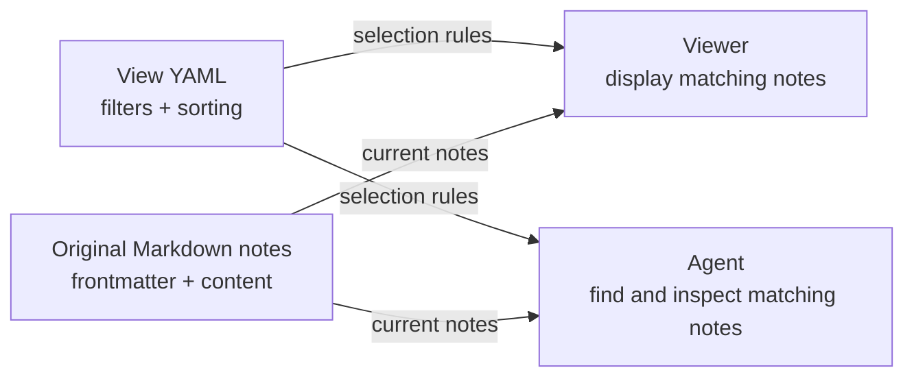

# Model Reference

The note model behind this template: the 17 note types, the file format and relationship fields, the capture-to-archive lifecycle, saved views, how to extend the model, and how it relates to other formats. Read [Second Brain template](README.md) first for what the template is and how to start; read this when you need the exact conventions.

## Note types

The template includes all 17 types below; there is no separate type pack to install. Start with one Responsibility for an ongoing area, one Project for a finite outcome, and a useful Source or general Note beneath it. The other types are available when useful, and some describe the template's own instructions and workflows. Recap is an explicitly optional extension.

| Note | Purpose |
| --- | --- |
| [Note](note.md) | General knowledge that does not yet need a more specific type. |
| [Project](project.md) | Current outcome, state, next actions and links for a finite effort. |
| [Responsibility](responsibility.md) | An ongoing area of ownership. |
| [Operation](operation.md) | A recurring activity, with its cadence and operating state. |
| [Source](source.md) | External material or a maintained file location, with provenance and a useful summary. |
| [Topic](topic.md) | A broad entry point for related notes and questions. |
| [Concept](concept.md) | A reusable idea or method. |
| [Question](question.md) | A consequential unresolved issue worth returning to. |
| [Opinion](opinion.md) | Your current stance, kept distinct from evidence. |
| [Person](person.md) | Relevant relationship, role and collaboration context about someone. |
| [Event](event.md) | A meeting, milestone or other occurrence worth remembering as an event. |
| [Recap](recap.md) | Optional reviewed summaries of discussions and activities over a day, month or year. |
| [Guide](guide.md) | Orientation and reference material, including the README and this note. |
| [Procedure](procedure.md) | How to perform a repeatable workflow. |
| [ADR](adr.md) | A lasting design decision, its rationale, alternatives and consequences. |
| [Skill](skill.md) | The visible catalogue entry for an executable agent Skill package. |
| [Type](type.md) | The definition, metadata and conventions for a category of notes. |

The [Portent model](https://portent.md/types) classifies work along two dimensions: its size and whether it recurs.

| Work | Usually one sitting | Spans several sittings |
| --- | --- | --- |
| One-off | Task | Project |
| Recurring or ongoing | Operation | Responsibility |

This template keeps small tasks in Project action lists or a task manager, so it does not bundle a Task Type. An Operation records that recurring work exists; a Procedure explains how to do it. A Responsibility implies ongoing ownership; a Topic groups knowledge without implying a commitment to maintain an outcome.

Work and knowledge belong in the same graph. Events, Notes, Topics and People provide context for work; this template adds more specific knowledge and system types. A Source preserves provenance; Concepts, Opinions and Project notes hold the useful synthesis. These choices adapt the model rather than claim conformance to every Portent convention.

You do not need to create examples of every type. When pruning a deployment, keep the definitions needed by its retained notes and remove affected links and workflows together.

Established Projects normally contain 600–1,200 words; a new or simple Project can be much shorter. Keep concise current state, 3–7 actions, prioritized Questions and Important Notes, and 3–5 milestones. Detailed evidence lives in linked notes. Long reference notes retain their payload and start with a short summary. The [Project](project.md) Type note is the authoritative contract.

## Files and relationships

Each note is one UTF-8 `.md` file. Its YAML header, called *frontmatter*, stores structured metadata; the Markdown body holds the text, headings, lists and source links. The first `#` heading is the display title, so a separate `title:` field is unnecessary. Filenames use kebab-case.

For example, a `benchmark-paper.md` Source might contain:

```markdown
---
type: Source
belongs_to:
  - "[[compare-analysis-methods]]"
related_to:
  - "[[generalisation]]"
url: https://example.org/benchmark-paper
_organized: true
---

# Benchmark paper

A summary of how Method A and Method B were compared, including the datasets,
evaluation criteria and limitations.

Original: [Benchmark paper](https://example.org/benchmark-paper).
See [[compare-analysis-methods|Compare two analysis methods]] for the current study.
```

Here, `type: Source` refers to the definition in [Source](source.md). `url` is ordinary metadata. `_organized: true` marks a note with a retrieval path. The quoted wikilinks connect it to other notes; these example targets illustrate the syntax and are not bundled notes.

Links in the body connect ideas in context. Relationship fields in the header give those connections an explicit meaning:

| Field | Meaning |
| --- | --- |
| `belongs_to` | The parent: the Project, Responsibility or other owning context. A durable note's chain of `belongs_to` must reach a Responsibility; see [ADR 0011](adr/0011-root-belongs-to-at-responsibilities-and-home-exploration-clusters-in-topics.md). |
| `related_to` | A lateral connection to another relevant note. |
| `has` | A selective list of important children or entry points, never a child's only link. |
| `surface_for` | Membership in a small human-facing project surface, selected by a saved view. |

These are shared conventions, not an exhaustive list of allowed relationships. A custom frontmatter field can express another relationship when its value is a quoted wikilink or a YAML list of wikilinks. No separate relationship definition file or registration step is required; [Tolaria detects these fields automatically](https://tolaria.md/concepts/relationships).

Document a relationship's meaning, direction, intended target kinds and whether it accepts one or several targets. Put Type-specific conventions in the relevant Type definition, and relationships shared across Types in this reference. Existing examples include `wraps` on [Skills](skill.md), `based_on` on [Recaps](recap.md) and `superseded_by` on [ADRs](adr.md). Optional fields in a Type's note template can make a relationship easier to discover; they are not a prerequisite for using it. Keep the established relationships above for their existing meanings.

Use YAML lists for multiple targets and quote wikilinks. `[[compare-analysis-methods]]` refers to a root filename without `.md`; `[[procedures/ingest-source]]` includes a vault-relative folder path. `[[compare-analysis-methods|Compare two analysis methods]]` supplies a readable label. A `has` list is curated and does not need to repeat every child or backlink.

Folders organize files; links and relationships describe their meaning. The [saved views](tolaria-saved-views.md) are separate `.yml` files that select and display existing notes without duplicating their content. Markdown, metadata, links, views and Git remain the durable system independently of the viewer or agent.

## Note lifecycle

Capture and organization are separate activities. Save useful material without first designing perfect metadata, then give it enough structure to find again. The [model's lifecycle](https://tolaria.md/templates/portent#lifecycle) also distinguishes retained history from active knowledge:

| State | Convention in this template |
| --- | --- |
| Captured | `_organized: false` identifies material still awaiting organization. |
| Organized | `_organized: true` means it has a clear title, suitable type and a useful retrieval path, such as a Project link, Topic or view. |
| Archived | `_archived: true` retains a note while excluding it from active views. |

These flags are separate from type-specific workflow fields: a Project can have `status: Active`, `Paused` or `Completed`, and a Question `status: Open`, `Answered` or `Deferred`. Completing work does not itself delete its notes. Archive retained inactive material according to the agreed retention policy, keeping useful evidence and provenance retrievable. See [Process Inbox](procedures/process-inbox.md) for the full organization and preservation rules.

Write organized notes directly when their retrieval path is already clear. Useful knowledge need not belong to an active Project: a Source or Concept can belong directly to its owning Responsibility. Do not invent a Project for every saved item. When no Project or Responsibility owns a note yet, file it under an exploration Topic of the Responsibility your deployment designates for exploratory reading, so that it has a home before it has a project ([ADR 0011](adr/0011-root-belongs-to-at-responsibilities-and-home-exploration-clusters-in-topics.md)).

## Saved views

A view saves the conditions for a useful recurring question, such as “Which questions are still open?” Its YAML file under `views/` defines filters, sorting and optional display columns. It contains the selection rules, not a stored copy of the results or another note type.



The template includes four examples:

| View | Selection | Example use by an agent |
| --- | --- | --- |
| Open Questions (`views/open-questions.yml`) | Unarchived Questions with `status: Open`. | Find questions to review, then read their current answers and evidence. |
| Evergreen Concepts (`views/evergreen-concepts.yml`) | Unarchived Concepts with `maturity: Evergreen`. | Find established ideas relevant to a task. |
| External Raw Sources (`views/external-raw-sources.yml`) | Unarchived Sources with a `root_key`. | Identify external-file pointers for a reference check. |
| Vault (`views/surface-vault.yml`) | Unarchived notes whose `surface_for` includes `"[[vault]]"`. | Find the curated entry points for this vault. |

**For people,** Tolaria renders the matching notes with the chosen sorting and columns. A project's human view is deliberately small, usually 3–5 notes: the Project, current work and a few useful entry points. Not every Project needs one.

**For agents,** a relevant view can provide a reusable starting selection. An agent can read the YAML, find matching notes from their frontmatter with filesystem tools or a script, and inspect the underlying content without opening Tolaria. Filters are useful for narrowing retrieval; icons, colors and columns mainly support presentation.

The file format is Tolaria-specific, and this repository does not bundle a standalone view executor. Reproducing exact results requires matching its filter and derived-field semantics. See [Tolaria Saved Views](tolaria-saved-views.md) for the contract.

Treat a view as a navigation aid within the task's scope. A curated human surface intentionally omits supporting Sources and historical detail; agents should follow Project links, relationships and targeted searches when more evidence is needed. Keep that human surface selective rather than expanding it into an exhaustive agent index. View membership grants no additional access to sources.

## Extending the model

The model is open to extension. Use existing types when they fit, and add structure when it solves a recurring retrieval or workflow need:

- **Add a field:** properties such as `priority`, `review_date` or an external identifier can be added to frontmatter. Document a field's meaning and expected values in the relevant Type or Guide, and use it consistently.
- **Add a relationship:** a field such as `depends_on` can hold quoted wikilinks without a separate declaration or registry. Document its meaning and direction in the relevant Type definition or the relationship reference above, and preserve existing relationship meanings.
- **Add a type:** create a root definition such as `organization.md` with `type: Type`, a first heading `# Organization`, and an explanation of when to use it. Notes in that category then use `type: Organization`. Follow the [Type conventions](type.md) and give the definition a retrieval path.
- **Extend a workflow or view:** update the relevant Procedure, Skill or saved-view configuration when the new structure should affect behavior. Adding a field alone does not create automation or guarantee that every application interprets it.

Prefer a property for a small distinction, such as `format: video` on a Source. Create a new Type when it needs a distinct template, relationships or workflow, as the [extension guidance](https://portent.md/implementation/extending-portent) recommends.

Type identities stay in English; `_sidebar_label` can localize their display. Preserve valid custom fields. Keys beginning with `_` are generally viewer or lifecycle metadata and should follow their documented conventions. This template supplies a shared starting model without requiring every vault to have the same domain-specific schema.

## Interoperability

You can open the notes in [Obsidian](https://help.obsidian.md/Files+and+folders/How+Obsidian+stores+data), but the template does not bundle an Obsidian configuration or plugins. Its type meanings and Tolaria saved views do not automatically become equivalent Obsidian behavior; configure the views and workflows you want in your chosen application.

The [LLM-wiki pattern](https://gist.github.com/karpathy/442a6bf555914893e9891c11519de94f) emphasizes a maintained knowledge layer between sources and answers. Here, the same principle extends to current work, decisions and responsibilities, with explicit write authority and external-file boundaries. Sources can remain in their canonical systems rather than being copied into a `raw/` folder.

Google Cloud's [Open Knowledge Format (OKF)](https://github.com/GoogleCloudPlatform/knowledge-catalog/blob/main/okf/SPEC.md) specifies standard Markdown cross-links and its own lifecycle and provenance conventions. This template uses wikilinks for its typed graph and type-specific status values. Unknown types and extra fields are allowed by OKF, but equivalent graph and lifecycle behavior needs an explicit mapping. This repository makes no OKF conformance claim and does not require Google services. See the OKF specification before relying on interchange with a particular consumer.

### Optional search and memory layers

Retrieval-augmented generation (RAG) supplies a model with relevant material retrieved for a task. Many implementations build a separate search index, often using text chunks and embeddings. This template's default path is direct file search and graph navigation: start from an entry note, inspect metadata and follow useful links. The relationships already exist in the Markdown files.

In the workflows used to develop this template, trials of [QMD](https://github.com/tobi/qmd) and [GBrain](https://github.com/garrytan/gbrain) did not show enough additional benefit to justify maintaining an extra retrieval stack. We therefore keep the default setup free of a separate index. The value of indexing depends on the workload; it may help when fuzzy recall or poorly connected material repeatedly defeats direct retrieval.

You can add a search layer over the same files, or integrate a broader memory system, when it solves a concrete need. QMD can index a Markdown folder; a GBrain integration also needs to account for its storage, relationship and writeback conventions. Keep the notes as the durable source of truth, make derived indexes rebuildable, and verify retrieved snippets against the underlying notes. These are optional extensions, not bundled integrations.
